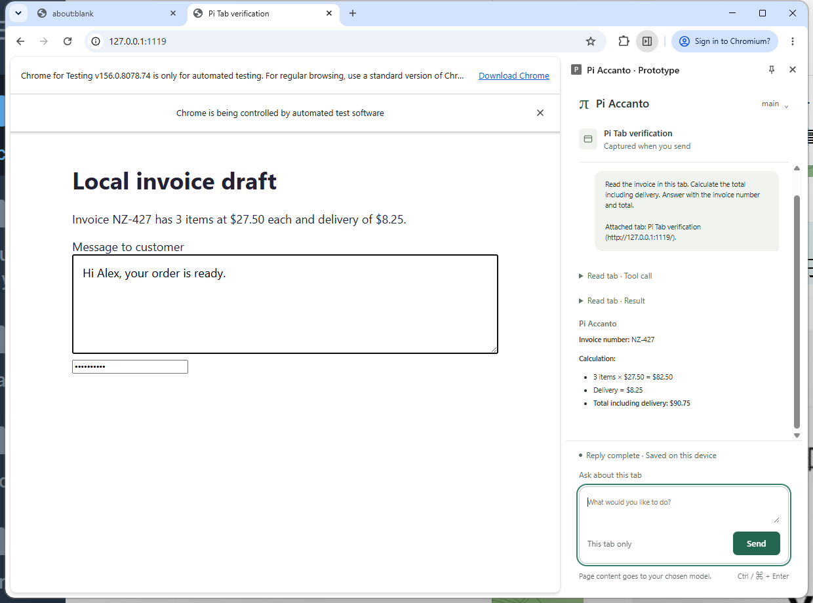
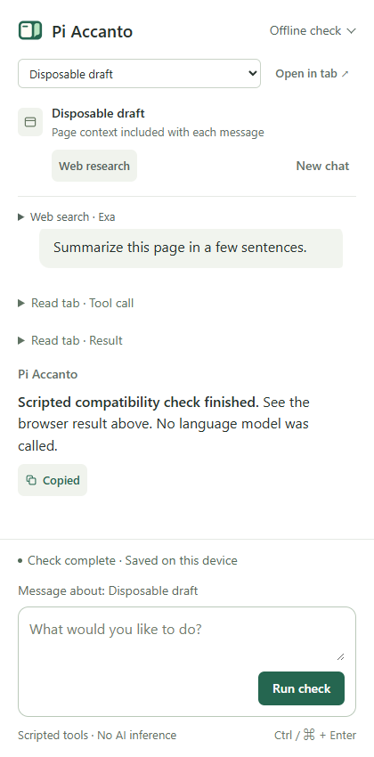
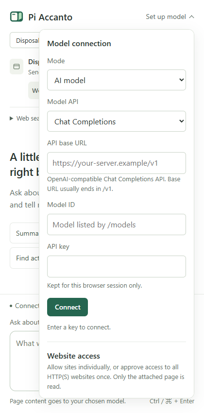
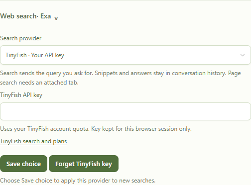

# Pi Accanto

**An AI assistant beside the page you already have open.**

Ask questions about a website or PDF, research the web, check a calculation,
or draft a reply without leaving your browser. *Accanto* is Italian for “beside.”

Pi Accanto runs as a Chrome extension. Bring your own compatible AI model;
there is no separate Pi process or browser-control server to install.

[](https://github.com/lsj5031/pi-accanto/actions/workflows/ci.yml)

Early release · [MIT license](LICENSE) · [Privacy](PRIVACY.md) ·
[Contributing](CONTRIBUTING.md)



Actual Chrome sidebar, using a real model on the included demo invoice.
The total is calculated from the page's inputs: 3 × $27.50 + $8.25 = $90.75.

## What can I ask it?

| What you want to do | Try asking |
| --- | --- |
| Understand a page | “Summarize this page and list the action items.” |
| Find a detail in a long document | “Find the cancellation fee, including later sections.” |
| Check the numbers | “Use Code Mode to read the prices and calculate the total. Show your working.” |
| Research a claim | “Search the web for evidence supporting this claim. Cite your sources.” |
| Read a PDF | “What are the main obligations? Include page numbers.” |
| Draft a reply | Focus a normal text field, then ask “Replace this draft with a polite confirmation.” |

You can ask follow-up questions naturally. Each message in a page chat includes
a fresh excerpt of the attached page, so you don't have to keep saying “this page.”
Pi can search later sections when the initial excerpt isn't enough.

Text edits stay in the field for you to review. Pi never clicks Submit.
Completed responses have a **Copy** button.

<details>
<summary>See Copy confirmation</summary>



</details>

## Get started

You need **Chrome**, **Node.js 22 or later**, and access to an
**AI model with tool calling and streaming**: OpenAI, Anthropic, Google Gemini,
or an OpenAI-compatible server. You'll need
its API base URL, exact model ID and API key. Chrome is tested; Edge is not yet verified.

### 1. Build and install the extension

1. [Download the source ZIP](https://github.com/lsj5031/pi-accanto/archive/refs/heads/main.zip)
   and extract it, or clone this repository.
2. Open a terminal in the extracted project folder and run:

   ```sh copy Copy Build Commands
   npm ci
   npm run build
   ```

3. Open `chrome://extensions` in Chrome and turn on **Developer mode**.
4. Click **Load unpacked** and select the newly created **dist** folder inside
   the project. Select `dist`, not the project folder itself.
5. Open Pi Accanto from Chrome's extensions menu. Pin it to the toolbar for easy access.

Keep the folder in the same location. To update later, download/pull the new
source, rebuild, and click **Reload** on Pi Accanto at `chrome://extensions`.

### 2. Connect your model

Open the control at the top right of Pi Accanto's header. On a fresh install,
it says **Set up model**.

1. Leave **Mode** set to **AI model**, then choose your **Model API**.
2. Use the provider's default **API base URL**, or enter your own server's URL.
3. Enter its exact **Model ID** and **API key**.
4. Click **Connect** and accept Chrome's request to access that server.

| Model API | Default API base URL | Key and model |
| --- | --- | --- |
| Chat Completions | Enter your OpenAI-compatible server's URL, usually ending in `/v1` | Your server's key and exact model ID. For OpenAI, use `https://api.openai.com/v1`. |
| OpenAI · Responses | `https://api.openai.com/v1` | OpenAI API key and model ID, such as `gpt-4.1-mini`. |
| Anthropic · Messages | `https://api.anthropic.com` | Anthropic API key and model ID, such as `claude-sonnet-4-6`. Do not add `/v1` to this base URL. |
| Google Gemini | `https://generativelanguage.googleapis.com/v1beta` | Gemini Developer API key and model ID, such as `gemini-2.5-flash`. Vertex AI credentials are not supported. |

These formats use Pi's upstream provider adapters. A ChatGPT, Claude or Gemini
chat subscription does not supply an API key. Model availability depends on your account.
Connect checks the server's model catalog (`/models`, Anthropic's `/v1/models/{id}`,
or Gemini's `/models/{id}`); it does not send a chat message.
There is no preset model or bundled key. Your chosen provider may charge for use.



The API format, URL and model ID are saved on this device. **API keys last only for the
browser session**: enter them again after restarting Chrome. Switching to a
different model endpoint or API format requires its own key.

### 3. Ask about a page

Open a website, open Pi Accanto and choose **Allow this site** if offered.
Accept Chrome's permission prompt, then send a question.

Chrome remembers site access; you don't need to click the extension icon before
every read. For fewer prompts, open the header's model settings and choose
**Website access → Allow all websites**. This is optional and can be removed there.
Only the attached page is read, even with all-site access.

The page named above the composer is the one Pi is using. Follow-ups stay with
it while you browse elsewhere. Choose **Chat about this tab** to switch pages,
or **New chat** to start fresh. After a browser restart, reattach the page;
saved conversations remain available in the conversation picker.

## Set up web search

**Search settings are under Web search, below the page controls.** Expand it to
choose a provider. Search is separate from the AI model connection.

| Provider | What you need |
| --- | --- |
| **Exa** (default) | No search account or API key. Uses Exa's shared hosted service; shared limits can make it unavailable. |
| **TinyFish** | Your [TinyFish Search API key](https://docs.tinyfish.ai/search-api). Select TinyFish, enter the key and click **Save choice**. Your account's quota applies. |
| **Brave** | Your [Brave Search API key](https://brave.com/search/api/) and a plan with **storage rights**, because search results are saved in conversation history. Select Brave, enter the key, confirm storage rights and click **Save choice**. |



Chrome may ask for access to the provider's API. Search keys are session-only,
just like the model key. **Forget key** removes the selected key and returns
search to Exa. Saving a key selects the provider; the next search checks its
credentials and quota. Pi never silently switches providers.

Choose **Web research** to start a conversation without reading the current tab,
or ask for web research within an existing page chat. Only the deliberate search
query is sent to the search provider.

Results first provide snippets. To read a full source, expand **Web sources**,
choose **Allow source** for that result, then ask Pi to read it. These approvals
are specific to the task and reset when you change tasks or reopen the panel.
Some sites can't be fetched directly; open and attach the source page instead.

If search is unavailable or rate-limited, **Open search in browser** opens the
query in a normal tab. It does not attach that tab automatically. On the page
you want to discuss, choose **New chat**, allow the site if needed, and send a message.

## What is Code Mode?

Code Mode lets the model write and run a small JavaScript program to read
approved page/search evidence and calculate from it. It is useful for totals,
comparisons and combining several reading steps. Expand the **Code Mode** tool
entries in the conversation to see the script, its output and nested reading activity.

The script runs locally in a **QuickJS sandbox**, in a separate browser worker.
It has no direct page, network, filesystem or credential access. It can call only
the approved reading/search tools; it cannot edit fields or submit forms.

### Try the included invoice demo

From the project folder, run:

```sh copy Copy Demo Command
npx --yes http-server docs/examples -a 127.0.0.1 -p 8123
```

Open `http://127.0.0.1:8123/code-mode-invoice.html` in Chrome, open Pi Accanto,
allow the site and start a **New chat**. Send:

```text copy Copy Invoice Prompt
Use Code Mode to read the invoice's actual quantity, unit price and delivery, calculate the total, and cite the page URL. Show the inputs and your working. Keep the answer concise.
```

The expected total is **$90.75**. Click **Load second invoice** on the page and
ask “Recalculate using Code Mode with the current invoice.” The new total should
be **$84.55**. The demo page doesn't display either answer, so this checks fresh
page reading as well as calculation. Use **Stop** to cancel a running reply.

## PDFs and multiple conversations

**PDFs:** Open a text-based PDF directly in Chrome and ask your question. Pi
extracts its text and can cite physical page numbers. Local PDFs also need
**Allow access to file URLs** in Pi Accanto's details at `chrome://extensions`.
Scanned PDFs need OCR, which is not supported. For an embedded viewer, open the
original PDF in its own tab.

**Concurrent tasks:** Each website tab has its own default conversation. Use the
conversation picker to resume one. For agents that keep working while you browse,
choose **Open in tab** before starting each reply and keep those agent tabs open.
Conversations have separate histories, attachments and Code Mode memory. Your model
server may still queue requests. Chrome can pause hidden sidebars; closing an
agent tab ends its runtime. If the same conversation is open elsewhere,
**Continue here** transfers it to the current panel.

## Privacy and current limits

Page excerpts, extracted PDF text, approved tool results and your messages go to
the model endpoint you configure. Conversations are saved locally in your browser
profile and can contain sensitive text. Search queries go to the selected search
provider. Read [Privacy](PRIVACY.md) before using private documents.

- Pi can read pages, search, calculate and replace ordinary text fields. It has
  no screenshot/vision, OCR, general clicking, automatic submission or autonomous navigation.
- Long pages and PDFs are read within limits; Pi reports omissions. Later HTML
  sections can be searched, and later PDF pages can be requested. PDF tables and
  reading order may be imperfect; encrypted PDFs are unsupported.
- Login requirements, redirects, expired links and site restrictions can prevent
  reading a source or PDF that you can see in Chrome.
- Model compatibility varies. Native APIs use Pi's bundled model profiles where
  available; unknown native models use a 128,000-token context and 4,096-token
  output profile. Chat Completions keeps its existing reasoning-enabled profile
  with 262,144 context and 65,536 output tokens. These limits are not yet editable.
- This is an early release. Edge and unattended execution with all views closed
  are not verified. See [the roadmap](https://github.com/lsj5031/pi-accanto/issues/1)
  for planned selection explanations, page highlights and table/CSV workflows.

## Troubleshooting

| Problem | What to try |
| --- | --- |
| **Send** is disabled | Connect your model first. Check the URL, exact model ID and key. |
| Model returns **403** | Check your server's host/origin policy. It must allow this extension's `chrome-extension://<extension-id>` origin; find the ID at `chrome://extensions`. Keep authentication and origin restrictions enabled. |
| Pi can't read the page | Choose **Allow this site**, then explicitly attach the page. Chrome's own pages and other extensions' pages cannot be read. |
| A key disappeared | Keys are deliberately session-only. Re-enter it after restarting Chrome. |
| Search fails | Check the selected provider, key and quota, or use **Open search in browser**. Exa's shared service can hit its limit. |
| Another panel owns the conversation | Choose **Continue here**, or return to the owning sidebar and choose **Open in tab**. |
| Want to try it without a model? | Select **Offline scripted check** in model settings and **Connect**. This tests browser tools without AI inference; explicit search/source commands can still access the network. |

## For developers

Built on Pi Durable 1.4.0, with bundled QuickJS WASM and PDF.js. Node is needed
for building/testing only. No native host or separate MCP process runs at runtime.
Model streaming and tool-call serialization use Pi AI's Chat Completions,
Responses, Anthropic Messages and Google Generative AI adapters.

```sh copy Copy Test Commands
npm ci
npx playwright install chromium
npm run build
npm run test:fixtures
```

On Linux, use `npx playwright install --with-deps chromium`. CI runs the four
fixture suites on Ubuntu 24.04 with Node 22; no model/search keys are required.
See [Contributing](CONTRIBUTING.md) for individual suites, optional live/native
checks, environment settings and test boundaries.

Original source and Beside artwork are [MIT licensed](LICENSE). Bundled dependencies
retain their own licenses; read [Third-party notices](THIRD_PARTY_NOTICES.md)
before distributing a prebuilt extension. The `private` npm flag prevents accidental
npm publication and does not restrict the source license.
