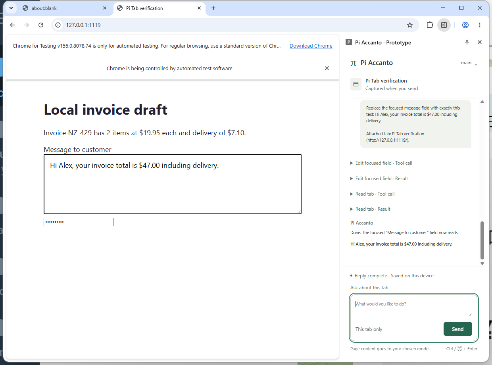

# Pi Accanto

A little help, right beside your tab. **Accanto** is Italian for “beside” or
“next to.”

An extension-only Pi Durable 1.4.0 prototype for Chrome/Edge. No native host,
BrowserMCP, separate Pi process, or WASM is needed. Node is used only to build
and test the extension, not at runtime.

## Screenshots

Read and calculate from an existing tab with the real model in Chrome's sidebar.


Replace a focused text field, verify the result, and leave the form unsubmitted.



## Try it

Run `npm ci` and `npm run build` to create the extension bundle.

The built extension is in `dist/`. In Chrome's `chrome://extensions` (or Edge's
`edge://extensions`), enable Developer mode, choose **Load unpacked**, and select
this checkout's `dist` directory. The existing verified checkout is at
`T:\playground\pi-browser-prototype`; keep that path to preserve its extension ID.

Open a disposable website and click this extension's toolbar action (or use
Alt+Shift+P if available). The explicit action handler grants temporary access
to that tab and opens the sidebar. Your first send attaches the conversation
to that tab. Follow-ups keep using it even when you browse other tabs; the
composer names the attachment. To change tasks, invoke the toolbar action on
the new tab, then choose **Use current tab**. This keeps earlier tasks visible
but starts fresh model context. Choosing the same attached tab keeps the current
sequence. **New conversation** clears the visible conversation and model context
and attaches to the current tab (older history stays in local storage).

Attachment survives panel reloads. A closed tab, lost permission, navigation
to another origin, or browser restart makes it unavailable; Pi never switches
to another tab automatically. Invoke the toolbar action and explicitly attach
again to recover. Normal navigation within the attached origin stays in the
same task; ask Pi to inspect again when the page changes.

In **Model connection**, select **Local model · main**, enter the endpoint's
API key, and click **Connect**. The extension checks that `/models` lists `main`.
The key stays in `chrome.storage.session`; it is not bundled, written to
IndexedDB, or restored after a browser restart. Then ask a page question, or
focus a normal text input/textarea and ask the assistant to replace its text.
Editing emits input/change events but never clicks Submit. Websites can react
to those events, so use a disposable page.

The Conversation UI defaults to light, including on a dark system theme.
Open the model control in the header for connection settings. Tool calls and
results are expandable; assistant replies render sanitized Markdown without
embedded images. Ctrl+Enter (or Cmd+Enter) sends; Enter inserts a new line.
Scrolling up pauses automatic following while new text arrives. Stop replaces
Send during a run, and completed instructions clear without erasing a new draft.

## Reading PDFs

Open a text-based PDF directly in Chrome, invoke Pi Accanto’s toolbar action,
and send your question (or choose **Use current tab** when changing tasks).
The extension detects Chrome’s PDF document type, including online URLs without
a `.pdf` suffix, fetches the original document with existing browser credentials,
and extracts text with bundled PDF.js 6.5.438 and a bundled worker. It does not
read the viewer DOM, load remote scripts, or use a native helper.

Local `file://` PDFs additionally require **Allow access to file URLs** in
Pi Accanto’s details at `chrome://extensions`. Chrome controls that setting;
the extension explains when it is missing. Local attachments bind to the exact
file URL as well as tab ID and browser session, so navigating to a different
local file requires an explicit attachment change.

Each read downloads at most 32 MiB and returns up to 8 physical PDF pages and
16,000 text characters, with page numbers, partial-page flags and notices when
anything is omitted. Pi can call `inspect_tab` with `start_page` to read later
pages. Text beyond the character limit on a single dense page is omitted.
Fetching and extraction time out after 30 seconds; Stop cancels a read.
Extracted text and its page references are saved in the local conversation,
then supplied to the configured model when answering. Full PDF bytes stay in
the extension reader and are not sent to the model.

Scanned/image-only and blank pages return an explicit **No extractable text**
notice. OCR and vision are unavailable. PDF editing and password-protected
documents are unsupported. Reading order and tables may be imperfect.
Authentication, expired links, cookie restrictions, redirects, HTTP errors and
damaged documents can prevent rereading a PDF that Chrome already displays;
the reader reports failure instead of inventing text. Redirects are rejected:
open the final original PDF URL directly. Embedded, browser-internal, extension,
`blob:` and `data:` viewers require opening the original PDF in its own ordinary
HTTP(S) or file tab. HTML inspection and focused-field editing still work normally.

The provider is `local-gguf`, at `http://192.168.1.111:11236/v1`, with model
`main`, OpenAI chat completions, reasoning enabled, and developer-role support
disabled. The supplied context/output limits and text/image model capabilities
are configured. Browser tools supply text only. CSP permits HTTP(S), local files
and bundled reader assets so PDFs can be fetched, while scripts/workers remain
restricted to the extension bundle. HTTP(S) host access still uses the explicit
toolbar `activeTab` grant (plus the existing model host permission); no all-sites
host permission was added. PDF fetches use only the validated attached document
URL and results are discarded if the tab changes while reading.

**Live workflow verified:** the actual Chrome for Testing 156.0.8078.74 sidebar
completed three invoice-reading cases ($90.75, $65.35, $47.00), three exact-text
edits without submission, password exclusion, streaming model requests, Stop,
recovery after Stop, and history/session-credential restoration after reload.
The offline regression suite also passes, including browser-restart history
persistence. These are prototype checks on a disposable fixture, not a claim of
compatibility with every website.

The initial live request failed with HTTP 403 because Splash rejected the
extension's Origin. With the user's approval, the Mitori runner's installed
`/Users/leo/Code/splash-runtime/current/server/http_security.py` now allows exactly
`chrome-extension://cpagjnnhdjoiccpfdnioojedbmeajjgp` through its same-origin
comparison, after Host and duplicate-header checks. Service `ai.mitori.splash`
was restarted. Other tested extension/web origins and untrusted Hosts remain
rejected. The extension does not strip Origin headers or disable browser
security. Loading the unpacked extension from a different path may change its
ID and require updating this allowance.

This is an installed-runtime patch; a Splash upgrade can overwrite it. To roll
it back, restore `if origins:` in that file, remove its two exception comments,
and restart the service. No launcher or launchd configuration was changed.
The server inspection also found that API-key authentication was already
unconfigured: inference without a key succeeds before and after the patch.
The origin exception preserves that existing setting; the extension's key
field does not mean the current server enforces authentication.

For a credential-free browser-tool check, choose **Offline scripted check**
and click **Connect**. Every instruction except `Type: ...` runs inspection;
`Type: replacement text` replaces the focused field. This uses Pi's real Faux
provider and performs no AI inference. Offline and live history use separate
IndexedDB databases.

## Architecture

- Sidebar owns the Pi harness for its lifetime.
- Pi Durable calls custom extension tools through `chrome.scripting`.
- IndexedDB stores the conversation, including inspected text and field contents.
- A Web Lock prevents two panels from opening the same store concurrently.
- Attachment is an application entry in Pi Durable's transcript, bound to tab ID,
  origin, and a browser-session token. Browser tools validate that binding.
- An explicit target change appends a supported `head: "self"` context boundary.
  Pi Durable excludes older messages/snapshots from model context without deleting
  history. The UI reads durable history separately, retaining earlier tasks with
  separators. Follow-ups never reset or prune the current task's context.
- Browser tools are not declared replay-safe. Old work is not explicitly resumed
  on startup; browser-session tokens prevent reusing old tab IDs after restart.
- Closing the panel destroys its runtime; history is restored on reopening.
  This does not promise unattended background execution or rollback of an action
  already dispatched.

## Build and checks

```powershell
npm ci
npm run build
npx playwright install chromium
npm test
npm run test:pdf
```

`npm test` loads the bundled MV3 extension in an isolated Chromium profile with
the scripted provider. It checks browser tool execution, password exclusion,
exclusive ownership, attached-tab read/edit follow-ups while browsing elsewhere,
explicit target changes, New conversation, unavailable targets, reload, and
browser-restart persistence/invalidation. It renders an
extension tab at sidebar width and grants the test copy loopback access.

`npm run test:pdf` uses isolated headless Chrome for Testing 156 profiles and
a loopback permission in the test copy. It checks asymmetric multipage text,
page selection and limits, local-file binding, scanned/empty pages, HTTP/login/
redirect/size errors, cancellation/recovery, navigation during extraction,
embedded-viewer guidance and HTML regression controls. PDF artifacts go under
`../.amp/in/artifacts/pi-accanto-pdf/`.

`npm run test:sidebar` runs the actual Windows Chrome sidebar. It uses native
mouse input on Chrome's Extensions menu and toolbar action, then attaches to
the real `SIDE_PANEL` target through CDP. The shipped manifest is unmodified;
the test asserts the action granted `activeTab` access. It enters the credential
from `%USERPROFILE%\.pi\agent\models.json` without logging it and attempts live
inference, then checks inspection, focused editing without submission, password
exclusion, Stop/recovery, and reload with the real model. It also runs the
scripted browser-tool controls independently. Multi-tab cases check follow-up
recall and fresh inspection of the original tab, enforcement of the toolbar grant
for a new tab, exclusion of prior tasks from actual model requests, fresh context
after New conversation, and rejection of closed targets before model invocation.
PDF cases use the real built-in viewer and toolbar grant, ask the live model
to combine facts across three pages, verify online and local-file answers,
preserve the PDF attachment while another tab is active, and check honest
answers for image-only pages and fetch denial.
It exits nonzero if live inference
fails, even when scripted controls pass. Screenshots and the response report
are saved under
`../.amp/in/artifacts/pi-browser-prototype/`.

The native test currently expects Chrome for Testing 156.0.8078.74, matching the
installed Chrome version, at
`../.amp/in/chrome-testing/chrome/win64-156.0.8078.74/chrome-win64/chrome.exe`.
Install it with `npx @puppeteer/browsers install chrome@156.0.8078.74 --path ../.amp/in/chrome-testing`.
Both tests use disposable browser profiles and fixture servers and clean them up.

The Beside mark pairs your page with its companion panel. Editable artwork
lives in `assets/beside.svg`; run `node generate-icons.mjs` to regenerate Chrome’s
16/32/48/128 px PNGs (requires Playwright Chromium). `npm run build` copies the
icon assets into `dist/assets`.

Unattended execution while the panel is closed and recovery of an action
interrupted by closing the browser are not promised. Edge has not been tested.
Code Mode / QuickJS WASM is not included.
