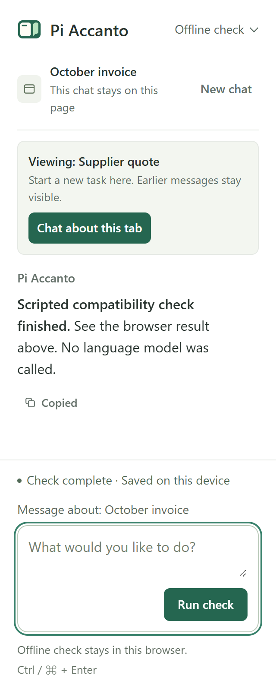

# Pi Accanto

A little help, right beside your tab. **Accanto** is Italian for “beside” or
“next to.”

An extension-only Pi Durable 1.4.0 assistant for Chrome/Edge. No native host,
BrowserMCP or separate Pi process is needed. Code Mode runs locally bundled
QuickJS WASM in a dedicated browser worker. Node is used only to build and test
the extension, not at runtime.

## What you can do today

Ask about the tab you already have open, keep a sequence of follow-up questions
attached to it, and prepare text without leaving the page.

| Task | Example prompt | Current behavior |
| --- | --- | --- |
| Understand a page | “What is the unit price?” | Includes a fresh HTML excerpt of up to 4,000 characters with every message; content later on the page may be omitted. |
| Find a passage | “Find the cancellation fee, including later sections.” | Searches visible HTML text beyond the initial excerpt and returns bounded passages and offsets. |
| Check an invoice | “Use Code Mode to calculate the total including delivery and show your working.” | QuickJS scripts compose approved reading tools and calculate from their results. |
| Research the web | Choose **Web research**, then “Search the web for this claim.” | Uses keyless Exa for sourced excerpts, with **Open search in browser** when unavailable. TinyFish and Brave are optional; individual source reads require approval. |
| Read a PDF | “What is the total, and which pages support it?” | Extracts text with physical page references from direct online or local PDFs, within the limits below. |
| Prepare a message | “Replace the focused field with a polite reply confirming this amount.” | Replaces an ordinary text input or textarea and reads back the result; it never clicks Submit. |
| Continue a task while browsing | “Check that amount again against the invoice.” | Keeps using the attached tab even when another tab is active. |
| Change tasks explicitly | Choose **Chat about this tab** when browsing another page, or **New chat**. | Switching pages keeps earlier messages visible with fresh model context. New chat clears the visible conversation and attaches on the next send. |

The current tools are **`inspect_tab`**, **`search_page`**, **`read_page_section`**,
**`web_search`**, **`read_web_source`**, **`codemode`**, and
**`type_in_focused_field`**. There is no screenshot/vision, OCR, general clicking,
or autonomous navigation. Chrome's native PDF viewer
is supported through text extraction; arbitrary rich-text editors are not.
Chrome has been tested; Edge compatibility is not yet verified.

## Where we want to take it

Web search, HTML page search and Code Mode are implemented, with verification
limits described below. The following remain planned capabilities:

- **Explain a selection:** start from highlighted text and its surrounding context.
- **Show the evidence:** jump to a relevant HTML passage and add a removable
  highlight. Current page search returns excerpts without changing the page.
- **Make tables useful:** extract structured rows, verify totals in a sandbox,
  and offer CSV downloads.
- **Compare and prepare:** explore explicitly attached multi-tab comparisons,
  local snapshot diffs, previewed form filling, and reversible page annotations.
- **Repeat useful tasks:** explore saved recipes that can pause for missing
  information, without promising background execution after the sidebar closes.

For example: “Where does this contract say I pay that fee?”, “Turn this pricing
table into a CSV and check its totals”, or “Compare this invoice with the quote
I attached.” Highlighting, export, and explicit multi-tab comparison workflows
still need implementation. Code Mode uses the upstream Pi Durable integration;
the build explicitly bundles its worker and QuickJS binary.

Track the proposed tools, examples, and acceptance criteria in
[the capability roadmap (#1)](https://github.com/lsj5031/pi-accanto/issues/1).

## Screenshots

Read and calculate from an existing tab with the real model in Chrome's sidebar.


Replace a focused text field, verify the result, and leave the form unsubmitted.


Completed answers include **Copy**, with confirmation after copying the original
Markdown. The following capture uses the real model in Chrome’s sidebar.


When you browse another tab, a contextual suggestion offers **Chat about this tab**.
The composer continues naming the original page until you explicitly switch.
This narrow-layout capture uses the offline scripted provider.



## Try it

Run `npm ci` and `npm run build` to create the extension bundle.

The built extension is in `dist/`. In Chrome's `chrome://extensions` (or Edge's
`edge://extensions`), enable Developer mode, choose **Load unpacked**, and select
this checkout's `dist` directory. The existing verified checkout is at
`T:\playground\pi-browser-prototype`; keep that path to preserve its extension ID.

Open a disposable website and open Pi Accanto from Chrome's side panel or its
toolbar action (Alt+Shift+P if available). If **Allow this site** appears, choose
it and accept Chrome's permission prompt. Chrome remembers this site's access;
revoke it in the extension's site-access settings whenever you want. The toolbar
action remains an alternative that grants temporary `activeTab` access.
Your first send attaches the conversation to that tab. Follow-ups keep using it
even when you browse other tabs; the composer names the attachment. To change
tasks, choose **Allow this site** if needed, then **Chat about this tab**.
This keeps earlier tasks visible but starts fresh model context. The suggestion
disappears when you return to the conversation's page, so normal follow-ups need
no tab decision. An unavailable attachment offers **Use this page** instead.
**New chat** clears the visible conversation and model context immediately,
without requiring access to the current tab. Your next send attaches to the
page you are viewing then (older history stays in local storage).

Attachment survives panel reloads. A closed tab, lost permission, navigation
to another origin, or browser restart makes it unavailable; Pi never switches
to another tab automatically. Return to that page, allow its site if needed,
and explicitly attach again to recover. Normal navigation within the attached
origin stays in the same task.

Every message in an HTML page chat includes a fresh excerpt of up to 4,000
characters from the attached page, plus its title and URL. You can ask “What is
the unit price?” without saying “this page.” Hidden text and form fields are
excluded from this automatic excerpt; the model can search/read later sections
with tools. PDF chats include document identity and use `inspect_tab` for PDF
text. **Web research** includes no attached-page excerpt. Only your question is
shown as your chat bubble; the excerpt stays in the model's context and local
conversation history.

### Independent conversations and concurrent agents

Each browser tab gets its own default conversation. The **Conversation** picker
above the page context lets you resume saved conversations; it does not combine
their histories. Conversations have separate databases, runtime locks, page
attachments, source approvals and Code Mode memory. Model/search configuration
and site permissions are shared across the browser profile.

For concurrent work, choose **Open in tab** before starting a reply in each
conversation. It moves that conversation into an ordinary browser tab and
restores its history. Keep those agent tabs open while you work elsewhere:
Agent A can research a contract while Agent B calculates an invoice. Stop or
handoff in one conversation does not affect the other. Your model endpoint may
queue simultaneous requests if it cannot serve them in parallel.

Chrome can pause a hidden tab-specific side panel, so hidden sidebars are not
the execution surface for long concurrent runs. **Open in tab** completes the
ownership handoff before activating the new tab. Closing an agent tab ends its
runtime; unattended execution with all its views closed is not supported.

After updating, reload the extension at `chrome://extensions`. History from
the earlier single-conversation build remains in **Earlier conversation** in
the picker. Browser restart invalidates old page attachments; choose a saved
conversation, then explicitly attach a page again. Saved history is retained.

If another panel has the conversation open, choose **Continue here**. Pi stops
any running reply, closes the other panel's runtime, and restores saved history
here. The other panel becomes inactive and can take the conversation back with
the same action. One panel writes each conversation at a time; different
conversations can run concurrently. If its owning sidebar is hidden, return to
that website and use **Open in tab** there before moving the conversation.

In **Model connection**, select **Local model · main**, enter the endpoint's
API key, and click **Connect**. The extension checks that `/models` lists `main`.
The key stays in `chrome.storage.session`; it is not bundled, written to
IndexedDB, or restored after a browser restart. Then ask a page question, or
focus a normal text input/textarea and ask the assistant to replace its text.
Editing emits input/change events but never clicks Submit. Websites can react
to those events, so use a disposable page.

The Conversation UI defaults to light, including on a dark system theme.
Replies and the composer use 16px text, explicitly overriding Chrome’s smaller
extension-body default; labels use 14px and supporting text uses 13px.
Open the model control in the header for connection settings. Tool calls and
results are expandable; assistant replies render sanitized Markdown without
embedded images. Completed replies have a **Copy** button that copies the original
response Markdown, with success or failure feedback. Ctrl+Enter (or Cmd+Enter)
sends; Enter inserts a new line.
Scrolling up pauses automatic following while new text arrives. Stop replaces
Send during a run, and completed instructions clear without erasing a new draft.

## Page search, web research and Code Mode

**Page search** stays on the attached tab. `search_page` finds literal,
case-insensitive text in up to 500,000 visible HTML characters, returns at most
10 excerpts and a continuation offset, and excludes form fields and inaccessible
frames. `read_page_section` reads a 4,000-character section at an offset. These
offsets belong to the current text snapshot; they are not durable anchors or
highlights. PDF reading continues to use `inspect_tab` with physical page numbers.

**Web search** defaults to [Exa's hosted MCP](https://exa.ai/docs/reference/exa-mcp)
without an account or API key. Only its MCP origin is granted at installation.
The extension calls `web_search_exa` directly over HTTPS; there is no Node MCP
server, cookie extraction or browser helper. This follows the keyless approach
in [pi-web-access](https://github.com/nicobailon/pi-web-access), while retaining
Pi Accanto's explicit source approvals and extension-only runtime.

Exa's shared free-plan limits apply. HTTP 200 can still contain a rate-limit or
tool error; these, network failures and unexpected response formats are reported
as failures, never as empty results or source evidence. Choose **Open search in
browser** to open the query in a normal DuckDuckGo tab. On a page you choose,
choose **New chat**, then **Allow this site** if offered; your next message attaches
that page. Opening browser search does not automatically read or attach its
results. Pi does not bypass CAPTCHAs, retry rate
limits or silently switch providers.

**Live verification:** a keyless request from the extension origin returned
three real MDN results; the final production-tool check returned six real results
and fetched MDN only after explicit source approval. Earlier production-tool
requests hit Exa's shared limit and correctly offered browser search. Live
success does not guarantee shared-pool availability. Captured-response replay
and synthetic protocol fixtures are recorded separately from real searches.

**TinyFish** is optional. Expand **Web search**, select **TinyFish**, enter your
own API key, then choose **Save choice**. Chrome requests access to its search
API origin. Requests use the [TinyFish Search API](https://docs.tinyfish.ai/search-api)
and your account quota; consult its current plans for usage and billing limits.
An additional authenticated extension-origin check, using the user's existing
key with permission, returned HTTP 200 and six real results with excerpts.
Session-only storage, cleared input, cookieless requests and **Forget TinyFish
key** were checked. No key is bundled or included in evidence. Invalid-key
rejection and synthetic result fixtures are recorded separately.

Brave's `/res/v1/web/search` API is also optional. Expand **Web search**, select
**Brave**, enter your own key and confirm your plan includes storage rights,
then choose **Save choice**. Chrome asks for access to Brave's API origin. The key stays
in `chrome.storage.session`, is cleared from the input, and can be removed with
**Forget Brave key** (or **Forget TinyFish key**). Forgetting the selected key
explicitly returns search to Exa. Enabling saves configuration; the next search checks credentials
and quota. A valid key with storage rights is required: the application saves
results in local conversation history and Code Mode journals. See
[Brave's plans](https://brave.com/search/api/) and
[terms](https://api-dashboard.search.brave.com/documentation/resources/terms-of-service).

Choose **Web research** to start a fresh model context without attaching or reading
a tab. You can also ask for web research about the existing attached page.
Only intentional query text is sent to the selected provider; the tool never automatically sends
page text or field values. Results contain titles, URLs, snippets and dates when
available. Snippets are explicitly marked as search evidence, not full-page reads.

Expand **Web sources**, choose **Allow source** for each exact URL you want read,
then ask Pi to read the allowed sources. Chrome requests that source's host access;
the application additionally restricts reading to the exact approved URL in this
task, even if Chrome already grants its origin. Up to 30 sources can be approved
per task. Source reads send no cookies, reject redirects, accept public HTML/plain
text, download at most 512,000 bytes, and return up to 12,000 characters with an
omission notice. Scripts, forms and embedded documents are excluded. A source
requiring login, JavaScript rendering, redirects or PDF extraction may fail; open
and attach it separately where supported. Searching and fetching never attach,
navigate or inspect unrelated tabs. Approvals reset on task changes or panel
restart; browser host grants alone do not restore them.

**Code Mode** uses `@earendil-works/pi-durable/codemode` and the portable upstream
QuickJS runtime through a dedicated worker. It can compose the five reading/search
tools and calculate from their results. Editing is model-only and is never exposed
to scripts; model-generation helpers are disabled. Scripts have no direct DOM,
Chrome APIs, network, credentials, Node or filesystem access. Each run has a
32 MiB VM limit, a 20,000-poll interrupt budget and a 30-second host deadline.
Stop cancels nested calls and terminates the worker; a subsequent run uses a new
worker. Script code, selected output, nested call status and failures remain
visible. Large output is bounded by upstream limits; there is no filesystem for
overflow files, so do not rely on omitted output being downloadable.

Upstream deterministic journaling and `store`/`load` are retained within a task.
Starting a new task atomically clears sandbox memory with the model context head.
Closing the panel stops its worker; interrupted runs do not acquire new source
approvals on reopening. Only reading tools are exposed and each nested call keeps
its own authorization and replay policy. No exactly-once guarantee is made for
external side effects, and scripts cannot perform them through the approved tools.

### Try Code Mode on an invoice

Code Mode runs **beside** the page, in an isolated worker. The model writes a
script, the script calls an approved reader such as `tools.inspect_tab({})`,
and JavaScript calculates from the returned text. `text(...)` returns selected
results to the model. Expand **Code Mode · Tool call** to see the script, and
**Code Mode · Result** to see its output and nested reading activity.

A disposable [invoice demo](docs/examples/code-mode-invoice.html) is included.
Serve it over HTTP from this checkout (local HTML files are not supported):

```sh copy Copy Demo Command
npx --yes http-server docs/examples -a 127.0.0.1 -p 8123
```

Open `http://127.0.0.1:8123/code-mode-invoice.html`, open Pi Accanto, allow this
site if asked, and start a **New chat**. Send:

```text copy Copy Invoice Prompt
Use Code Mode to read the invoice's actual quantity, unit price and delivery, calculate the total, and cite the page URL. Show the inputs and your working.
```

The first invoice is 3 × $27.50 + $8.25 = **$90.75**. Click **Load second
invoice** in the page, then ask “Recalculate using Code Mode with the current
invoice.” It must read again and calculate 4 × $19.60 + $6.15 = **$84.55**.
The page does not display either answer. This checks that Pi reads fresh inputs
and executes a calculation instead of repeating a remembered total. The
research suite exercises this same demo, including its changed values, and
separately rejects editing/direct browser APIs and verifies Stop and limits.

## Reading PDFs

Open a text-based PDF directly in Chrome and open Pi Accanto. Allow its site if
requested, then send your question (or choose **Chat about this tab** when changing tasks).
The extension detects Chrome’s PDF document type, including online URLs without
a `.pdf` suffix, fetches the original document with existing browser credentials,
and extracts text with bundled PDF.js 6.5.438 and a bundled worker. It does not
read the viewer DOM, load remote scripts, or use a native helper.

Local `file://` PDFs additionally require **Allow access to file URLs** in
Pi Accanto’s details at `chrome://extensions`. Chrome controls that setting;
the extension explains when it is missing. Local attachments bind to the exact
file URL as well as tab ID and browser session, so navigating to a different
local file requires an explicit attachment change.

Each read downloads at most 32 MiB and returns up to 8 physical PDF pages and
16,000 text characters, with page numbers, partial-page flags and notices when
anything is omitted. Pi can call `inspect_tab` with `start_page` to read later
pages. Text beyond the character limit on a single dense page is omitted.
Fetching and extraction time out after 30 seconds; Stop cancels a read.
Extracted text and its page references are saved in the local conversation,
then supplied to the configured model when answering. Full PDF bytes stay in
the extension reader and are not sent to the model.

Scanned/image-only and blank pages return an explicit **No extractable text**
notice. OCR and vision are unavailable. PDF editing and password-protected
documents are unsupported. Reading order and tables may be imperfect.
Authentication, expired links, cookie restrictions, redirects, HTTP errors and
damaged documents can prevent rereading a PDF that Chrome already displays;
the reader reports failure instead of inventing text. Redirects are rejected:
open the final original PDF URL directly. Embedded, browser-internal, extension,
`blob:` and `data:` viewers require opening the original PDF in its own ordinary
HTTP(S) or file tab. HTML inspection and focused-field editing still work normally.

The provider is `local-gguf`, at `http://192.168.1.111:11236/v1`, with model
`main`, OpenAI chat completions, reasoning enabled, and developer-role support
disabled. The supplied context/output limits and text/image model capabilities
are configured. Browser tools supply text only. CSP permits HTTP(S), local files
and bundled reader assets so PDFs can be fetched, while scripts/workers remain
restricted to the extension bundle, with `wasm-unsafe-eval` for locally bundled
QuickJS. The `tabs` permission supplies titles and URLs for the sidebar's current
site prompt; it does not grant page-content access. Attached-tab content requires
an explicit **Allow this site** host grant or temporary toolbar `activeTab`
access. The Exa MCP host is granted at installation for keyless
search. Optional HTTP(S) origins are declared for page access, TinyFish, Brave and user-approved source
reads; they are requested individually, with no automatic all-sites grant.
PDF fetches use only the validated attached document
URL and results are discarded if the tab changes while reading.

**Live workflow verified:** the actual Chrome for Testing 156.0.8078.74 sidebar
completed three invoice-reading cases ($90.75, $65.35, $47.00), three exact-text
edits without submission, password exclusion, streaming model requests, Stop,
recovery after Stop, and history/session-credential restoration after reload.
The offline regression suite also passes, including browser-restart history
persistence. These are checks on a disposable fixture, not a claim of
compatibility with every website.

The initial live request failed with HTTP 403 because Splash rejected the
extension's Origin. With the user's approval, the Mitori runner's installed
`/Users/leo/Code/splash-runtime/current/server/http_security.py` now allows exactly
`chrome-extension://cpagjnnhdjoiccpfdnioojedbmeajjgp` through its same-origin
comparison, after Host and duplicate-header checks. Service `ai.mitori.splash`
was restarted. Other tested extension/web origins and untrusted Hosts remain
rejected. The extension does not strip Origin headers or disable browser
security. Loading the unpacked extension from a different path may change its
ID and require updating this allowance.

This is an installed-runtime patch; a Splash upgrade can overwrite it. To roll
it back, restore `if origins:` in that file, remove its two exception comments,
and restart the service. No launcher or launchd configuration was changed.
The server inspection also found that API-key authentication was already
unconfigured: inference without a key succeeds before and after the patch.
The origin exception preserves that existing setting; the extension's key
field does not mean the current server enforces authentication.

For a credential-free browser-tool check, choose **Offline scripted check**
and click **Connect**. `Type: replacement text` replaces the focused field,
`Find: literal phrase` searches the attached HTML page, and `Code: JavaScript`
runs the sandbox. `Search: public query` calls the selected provider (Exa
needs no key; optional TinyFish and Brave require configuration), and `Read source: URL`
reads an approved result. Other instructions
run inspection. This uses Pi's real Faux provider and performs no AI inference.
Offline and live history use separate IndexedDB databases. Scripted checks can
still access the network through explicitly invoked search/source tools.

## Architecture

- Each sidebar or agent tab owns its conversation's Pi harness for its lifetime.
- The service worker serializes conversation-catalog and per-tab mapping updates.
  Tab mappings and the browser-session token live in session storage; conversation
  IDs/titles are saved locally. Closing a website does not delete its history.
- Pi Durable calls custom extension tools through `chrome.scripting`.
- Each conversation has its own IndexedDB database, including inspected text and
  field contents, with separate live/scripted stores. Earlier stores are retained.
- A conversation-specific Web Lock prevents two panels from opening the same
  store concurrently; different conversations have independent locks.
  **Continue here** requests a cooperative handoff over BroadcastChannel; the
  old owner aborts/joins its tasks and closes storage before releasing the lock.
- Attachment is an application entry in Pi Durable's transcript, bound to tab ID,
  origin, and a browser-session token. Browser tools validate that binding.
- An explicit target change appends a supported `head: "self"` context boundary.
  Pi Durable excludes older messages/snapshots from model context without deleting
  history. The UI reads durable history separately, retaining earlier tasks with
  separators. Follow-ups never reset or prune the current task's context.
- Browser tools are not declared replay-safe. Old work is not explicitly resumed
  on startup; browser-session tokens prevent reusing old tab IDs after restart.
- Closing the panel destroys its runtime; history is restored on reopening.
  This does not promise unattended background execution or rollback of an action
  already dispatched.

## Build and checks

```powershell
npm ci
npm run build
npx playwright install chromium
npm test
npm run test:pdf
npm run test:conversations
```

`npm test` loads the bundled MV3 extension in an isolated Chromium profile with
the scripted provider. It checks browser tool execution, password exclusion,
exclusive ownership, attached-tab read/edit follow-ups while browsing elsewhere,
explicit target changes, permission-independent **New chat** and its detached
reload state, exact Markdown copying, unavailable targets, reload, and
browser-restart persistence/invalidation. It also checks the actual 16px composer
and response sizes. It renders an
extension tab at sidebar width and grants the test copy loopback access.

`npm run test:pdf` uses isolated headless Chrome for Testing 156 profiles and
a loopback permission in the test copy. It checks asymmetric multipage text,
page selection and limits, local-file binding, scanned/empty pages, HTTP/login/
redirect/size errors, cancellation/recovery, navigation during extraction,
embedded-viewer guidance and HTML regression controls. PDF artifacts go under
`../.amp/in/artifacts/pi-accanto-pdf/`.

`npm run test:conversations` starts two independent tab-bound conversations and
holds both Code Mode workers at a fixture search request simultaneously. It
checks Stop/handoff isolation, separate histories and sandbox values, per-task
source approvals, saved-conversation selection, Open in tab, and reload. Fixture
results do not consume provider quota. It also captures the 320px layout.
Evidence is under `../.amp/in/artifacts/pi-accanto-conversations/`.

`npm run test:sidebar` runs the actual Windows Chrome sidebar. It uses native
mouse input on Chrome's Extensions menu and toolbar action, then attaches to
the real `SIDE_PANEL` target through CDP. The shipped manifest is unmodified;
the test asserts the action granted `activeTab` access. It enters the credential
from `%USERPROFILE%\.pi\agent\models.json` without logging it and attempts live
inference, then checks inspection, focused editing without submission, password
exclusion, Stop/recovery, and reload with the real model. It also runs the
scripted browser-tool controls independently. Before browsing other tabs, it
uses **Open in tab** to transfer the conversation and records that transition
separately: hidden tab-specific sidebars can pause. Multi-tab cases then run in
that ordinary agent tab and check follow-up recall and fresh excerpts from the
original tab, a site-access request
and real Chrome confirmation for a new tab, exclusion of prior tasks from actual model requests, fresh context
after **New chat**, and rejection of closed targets before model invocation.
The native sidebar also checks copying a real-model answer to the system clipboard.
PDF cases use the real built-in viewer and the remembered site grant, ask the live model
to combine facts across three pages, verify online and local-file answers,
preserve the PDF attachment while another tab is active, and check honest
answers for image-only pages and fetch denial.
It exits nonzero if live inference
fails, even when scripted controls pass. Screenshots and the response report
are saved under
`../.amp/in/artifacts/pi-browser-prototype/`.

The native test currently expects Chrome for Testing 156.0.8078.74, matching the
installed Chrome version, at
`../.amp/in/chrome-testing/chrome/win64-156.0.8078.74/chrome-win64/chrome.exe`.
Install it with `npx @puppeteer/browsers install chrome@156.0.8078.74 --path ../.amp/in/chrome-testing`.
Both tests use disposable browser profiles and fixture servers and clean them up.

`npm run test:research` exercises the built MV3 extension at 380px/DPR 2:
HTML search beyond 4,000 characters, field exclusion, independently checked
$90.75 and $84.55 calculations from changing demo inputs, implicit page questions
and updated values in actual model requests, unapproved tool rejection, missing
global APIs, infinite-loop and memory limits, partial source failure, Stop during
a pending source call, recovery, two-panel handoff during a read, and task/approval isolation. Provider HTTP 422
with an invalid key is checked against the real Brave endpoint; TinyFish's real
invalid-key response is also recorded. Successful keyed search responses, empty
results and HTTP 429 use explicit fixtures: no authenticated TinyFish or Brave
success is claimed without a supplied key. The test attempts a real keyless Exa
search from the extension origin and records its outcome separately from
protocol fixtures. Shared-limit metadata, RPC/tool errors and unrecognized
content must produce browser fallback, not fabricated results. A separately
approved MDN read uses the actual public source. The real local model chooses
page-search tools and writes calculations; because the disposable extension ID
is outside its server's Origin allowlist, that part uses a test-only Node relay.
The shipped extension has no relay and retains direct transport. A separate
Chrome 156 `SIDE_PANEL` check opened the canonical extension through a temporary
test button, used direct model transport, and executed a model-written Code Mode
calculation to $90.75. That evidence is separate from `test:sidebar`, which also
exercises native opening and site permissions.
Artifacts and the report are under `../.amp/in/artifacts/pi-accanto-research/`.
The report is saved on failures as well as successes and includes model request
bodies, response streams, and the sidebar transcript; failed runs also capture
a screenshot. Authorization headers are not recorded. The live web scenario
uses an explicit fixture search target and requires a new search in that task
before approving a result and checking its full text and citation.
An additional one-off authenticated TinyFish check used the same built extension
and its production search tool against the real API, without response fixtures
or a relay. It returned six parsed results including the MDN map reference and
verified session-only key handling and explicit forgetting. Its sanitized report
is `tinyfish-authenticated-report.json` in the same artifacts directory. The
ordinary suite does not automatically load a personal TinyFish credential or
consume its quota; its TinyFish success cases remain synthetic fixtures.
Native menu automation requires an interactive Windows desktop. Earlier menu-driver
failures before sidebar initialization were also reproduced on the untouched
baseline; they are recorded separately from successful direct-side-panel checks.

The Beside mark pairs your page with its companion panel. Editable artwork
lives in `assets/beside.svg`; run `node generate-icons.mjs` to regenerate Chrome’s
16/32/48/128 px PNGs (requires Playwright Chromium). `npm run build` copies the
icon assets into `dist/assets`.

Unattended execution while the panel is closed and recovery of an action
interrupted by closing the browser are not promised. Edge has not been tested.
Code Mode / QuickJS WASM is bundled locally; no remote sandbox is used.
