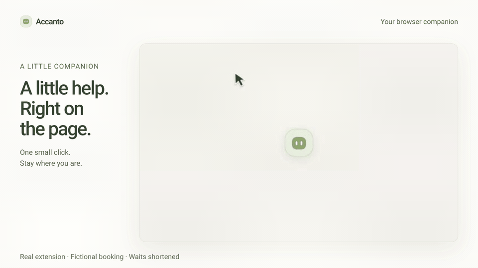
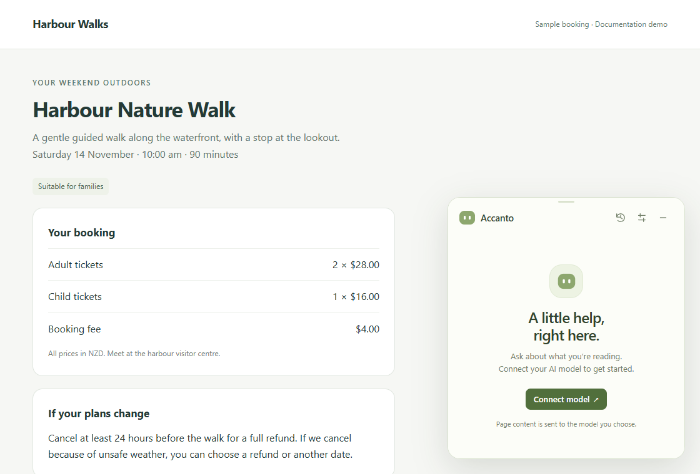
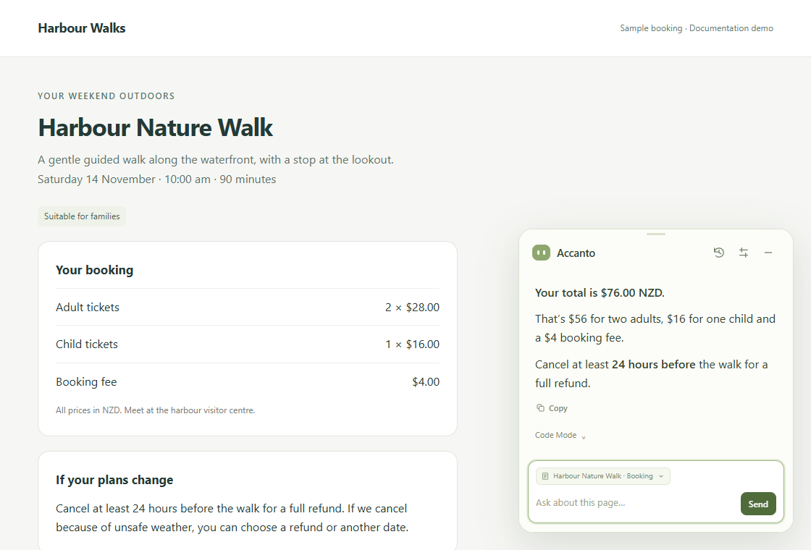
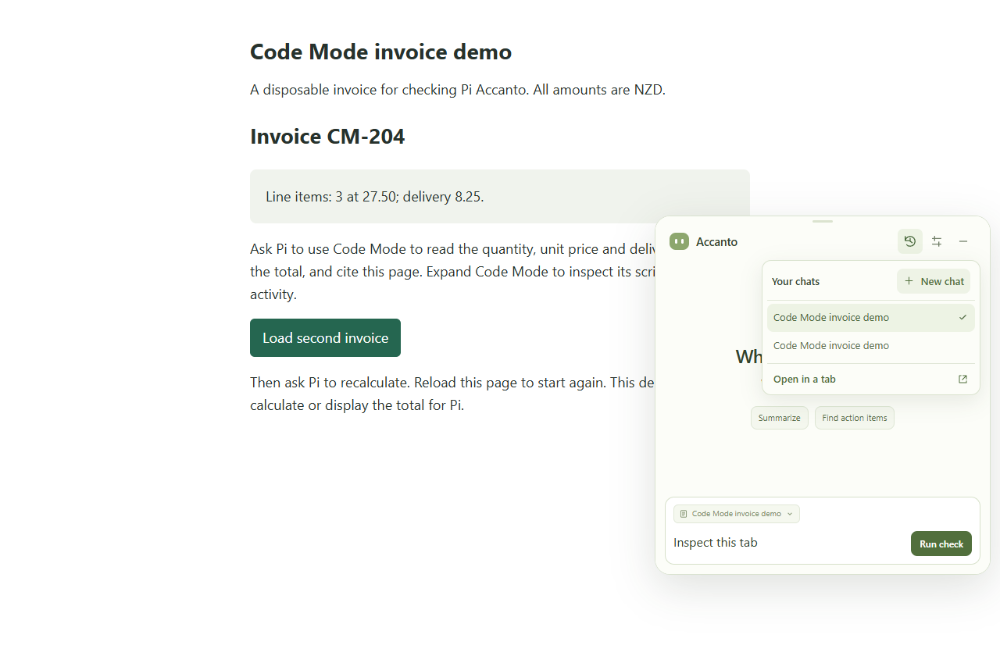

# Pi Accanto

**A little help, right beside what you're reading.**

Ask about a page, make sense of a PDF, check a total or research a question.
Accanto lives in a small floating window in Chrome. When you're done, it tucks
back into a quiet little companion in the corner. *Accanto* means “beside” in Italian.

[Get started](#get-started) · [Everyday use](#make-yourself-at-home) · [Web search](#search-the-web) · [Privacy](PRIVACY.md)

[](https://github.com/lsj5031/pi-accanto/actions/workflows/ci.yml)

## See it in action



[Watch the 25-second demo with sound](docs/media/companion-tour.mp4) for a sharper view.
See the companion come to life, answer a question about a booking, calculate its
total with Code Mode, and search the web with your approval to read a source.

Recorded in the real extension with a live model, real search results and source
reading. The booking is fictional and waiting times are shortened; this is a
feature demo, not a speed benchmark. Made with [Brag](https://github.com/latent-spaces/brag).

Video music: [Sascha Ende](https://ende.app), “Happy Beats / Business Moves Vol. 9”
([CC BY 4.0](https://creativecommons.org/licenses/by/4.0/)); excerpt mixed with fades.

## What can it help with?

| You're looking at… | Try asking… |
| --- | --- |
| A booking or order | “What's my total, and when can I cancel?” |
| A long article | “Summarize the main points. What should I follow up on?” |
| A contract or PDF | “What do I need to do, and by when? Include page numbers.” |
| A claim you want to check | “Look for supporting evidence on the web. Cite the sources.” |
| A draft in a text field | “Replace this with a friendly, concise reply.” |

Follow-ups work naturally: each page-chat message includes a fresh excerpt of the
attached page. You don't have to repeat “this page.” Accanto can search later
sections when the first excerpt isn't enough.

Text replacements stay in the field for you to review. Accanto never clicks Submit.

## Get started

You'll need **Chrome** and an
**AI provider's API key**. OpenAI, Anthropic, Google Gemini and OpenAI-compatible
servers are supported. Your provider may charge for use; a chat subscription
doesn't include an API key.

This is an early release installed as an unpacked extension. There is no Chrome
Web Store installer yet. Use a ready-built download when available, or build
from source with **Node.js 22 or later**. No separate server or CLI runs while
you use Accanto.

### 1. Install in Chrome

**Ready-built download (no Node.js required):**

1. Open [Build and fixture tests](https://github.com/lsj5031/pi-accanto/actions/workflows/ci.yml)
   and choose a successful run on **main**. Download its **extension-download**
   artifact (GitHub sign-in is required; artifacts expire).
2. Extract the artifact, then extract the **`pi-accanto-VERSION.zip`** inside it
   into a permanent folder.
3. Open `chrome://extensions`, enable **Developer mode**, choose **Load unpacked**,
   and select the extracted folder containing **`manifest.json`**.
4. Open a normal webpage and click Pi Accanto in Chrome's extensions menu.

GitHub's **Source code (zip)** downloads are not ready-built extensions.
If no build artifact is available, use the source build below.

**Build from source:**

1. [Download the source ZIP](https://github.com/lsj5031/pi-accanto/archive/refs/heads/main.zip)
   and extract it, or clone this repository.
2. Open a terminal in that folder and run:

   ```sh
   npm ci
   npm run build
   ```

3. Open `chrome://extensions` and enable **Developer mode**.
4. Choose **Load unpacked** and select the **dist** folder created inside the project.
5. Open a normal webpage, then click Pi Accanto in Chrome's extensions menu.
   Pin it to the toolbar if you'd like.

Select **dist**, not the project folder. Loading the source folder shows build
instructions rather than starting the assistant.

Keep the installed folder where it is. To update a download, extract the new
extension ZIP into that same folder. For source installs, pull the latest source
and rebuild. Then reload the extension at `chrome://extensions` and refresh your
webpages.

**Stable extension identity:** builds use the ID
`iojliefpiallbakabkahmiaadgmlfjkf`, regardless of their installation folder.
If your API gateway restricts browser origins, allow
`chrome-extension://iojliefpiallbakabkahmiaadgmlfjkf` explicitly. This does not
grant website access or bypass the gateway's authentication.

**Upgrading an older, path-based install:** the new ID is a separate extension
identity. Before removing the old copy, preserve any chat history you need and
make sure you can re-enter your API keys. Load the new build, reconnect your model
and approve website access again, then remove the old copy. Chrome does not
automatically migrate its chats, keys or permissions to the new ID.

### 2. Connect your AI model

Click **Connect model**. Settings open in a separate extension tab, where you
choose your provider, enter the model ID and API key, and click **Connect**.
Accept Chrome's request to access that provider if prompted.



Choose your provider's native format when available. The base URL fills in for
OpenAI Responses, Anthropic and Gemini; custom servers need their own URL.
A green **Connected** confirmation means your settings and model-catalog check
succeeded. It doesn't send a chat message or guarantee future service availability.

<details>
<summary>Which model format and URL should I use?</summary>

| Model API | API base URL | What to enter |
| --- | --- | --- |
| OpenAI · Responses | `https://api.openai.com/v1` | Your OpenAI API key and an exact model ID available to your account. |
| Anthropic · Messages | `https://api.anthropic.com` | Your Anthropic API key and model ID. Don't append `/v1`. |
| Google Gemini | `https://generativelanguage.googleapis.com/v1beta` | Your Gemini Developer API key and model ID. Vertex AI credentials aren't supported. |
| Chat Completions | Your server's base URL, usually ending in `/v1` | An OpenAI-compatible server's key and model ID. OpenAI also supports this format at `https://api.openai.com/v1`. |

The model needs streaming and tool calling. These formats use Pi's upstream
provider adapters. API format, URL and model ID are saved on your device.
Changing the endpoint or API format requires the corresponding key.

</details>

**Keys are remembered on this device by default**, so restarting Chrome doesn't
disconnect your model. Uncheck **Remember API key on this device** before
connecting for session-only storage. **Forget key** removes the key while keeping
your endpoint and model settings.

Remembered keys live in this extension's local Chrome profile storage. They aren't
synced or shared with websites; this isn't an encrypted OS credential vault.

### 3. Ask your first question

Choose **Allow this site** if offered, accept Chrome's permission prompt, and ask
something about the page. The small chip above the input tells you which page
Accanto is using. **Stop** cancels a reply; **Copy** copies a completed answer.

Once you allow a website, the companion appears automatically on future visits.
You can optionally enable **Settings → Website access → Allow all websites**.
This makes access easier; it doesn't attach or read every open tab.



## Make yourself at home

The companion stays out of the way until you need it. Hover for its small lift and
friendly eye change, then click to open. Reduced-motion preferences are respected.


| Want to… | Here's how |
| --- | --- |
| Open Accanto from the keyboard | Press **Alt + Shift + Q** (**Option + Shift + Q** on Mac). |
| See keyboard shortcuts | Click **?** in the header to see Chrome's actual assignments. **Customize in Chrome** lets you change any of them. |
| Put it away | Click **−** or press **Escape**. A running reply continues while minimized. |
| Move it | Drag the small grip at the top. |
| Make room for a longer chat | Click the expand icon or press **Alt + Shift + D** to enlarge. Press again to restore the previous size and position. |
| Start fresh or return to a chat | Open **History** in the header. Choose **New chat** or a saved conversation. |
| Ask without reading this page | Open the page-context chip and choose **Web only**. |
| Keep working while you navigate | Press **Alt + Shift + S** or choose **History → Open in a tab** before starting the reply. The conversation and its page context move together. Keep that assistant tab open. |
| Hide the companion on a website | Right-click the small companion and choose **Hide on this site**. The toolbar can bring it back. |

These three Chrome-managed shortcuts work while browsing, including when focus is
outside Accanto. On Mac, use **Option** for **Alt**. Chrome may keep older assignments
after an update or leave a shortcut unassigned when another extension uses it.
The help dialog shows this; check or change any shortcut at `chrome://extensions/shortcuts`.

Opening Accanto from Chrome's New Tab page starts a chat with **no tab attached**.
You can ask a question or search the web immediately, without trying to read an
empty browser-internal page. Opening an existing chat in a tab keeps its attachment.



Long chat lists scroll inside the menu. The input grows with your draft and clears
as soon as you send, so you can start typing the next question.

Each website tab has its own conversation and can work concurrently. Navigating
or reloading a webpage closes its agent; saved history returns, but an interrupted
reply doesn't automatically resume. Use **Open in a tab** for work that needs to
survive navigation. After a browser restart, reattach the page explicitly.

PDFs and pages that can't host the floating companion open a separate assistant
tab. Local PDFs need **Allow access to file URLs** in the extension's Chrome
settings. Chrome's own pages can't be read. Accanto doesn't use Chrome's sidebar.

## Search the web

Search works out of the box with **Exa's shared service**, with no search key.
Shared limits sometimes make it unavailable. For your own search account, open
**Settings → Web search** and select a provider:

| Provider | Setup |
| --- | --- |
| **Exa** | Default. No search account or key required; shared limits apply. |
| **TinyFish** | Enter your [TinyFish Search API key](https://docs.tinyfish.ai/search-api), then **Save choice**. |
| **Brave** | Enter your [Brave Search API key](https://brave.com/search/api/), confirm your plan has **storage rights**, then **Save choice**. Results are saved in chat history. |


Search keys use the same **Remember API key on this device** choice. **Forget key**
removes both remembered and session copies of the selected key and returns search
to Exa. Accanto doesn't silently switch providers when a search fails.

Search results start with snippets. Accanto can read the full text of exact
results returned in the current task using your existing Chrome website access.
There is no separate per-result approval. **Allow all websites** also covers
source reading.

If Chrome access is missing, click **Allow website** beside the blocked action
or in **Web sources**. Accept Chrome's permission prompt, then send a follow-up
to retry the read. Chrome remembers the website grant until you revoke it;
granting access alone doesn't fetch a page or send another model request.

If a provider is blocked or rate-limited, **Open search in browser** opens the query
in a normal tab. To discuss a result, open its page and start a chat there; opening
search doesn't attach the new tab automatically.

## Curious about the calculation?

**Code Mode** lets the model run a short JavaScript program over approved page or
search evidence. It helps with totals, comparisons and several reading steps.
Expand the activity below an answer, then **Code Mode**, to see the script and output.

The program runs locally in a QuickJS sandbox in a separate browser worker.
It can't directly access the page, network, files or API keys, and it can't edit
fields or submit forms. Only the approved reading and search tools are available.

<details>
<summary>Try a calculation yourself</summary>

From the project folder, start the included sample page:

```sh
npx --yes http-server docs/examples -a 127.0.0.1 -p 8123
```

Open `http://127.0.0.1:8123/code-mode-invoice.html`, allow the site in Accanto,
start a **New chat**, and ask:

> Use Code Mode to read the quantity, unit price and delivery charge. Calculate
> the total, cite this page and show your working.

The total should be **$90.75**. Click **Load second invoice** on the page and ask
it to recalculate; the new total should be **$84.55**. The page doesn't display
either answer, so this also checks that Accanto reads the updated page.

</details>

## A few things to know

- **Your chosen model receives your messages and page evidence.** Conversations
  are stored locally in your Chrome profile and may contain private text. Search
  queries go to the selected search provider. Read [Privacy](PRIVACY.md).
- **You stay in control.** Accanto can read, search, calculate and replace ordinary
  text fields. It doesn't autonomously navigate, click buttons or submit forms.
- **Some content needs another approach.** Scanned PDFs need OCR, which isn't
  supported. Password fields are excluded. Login walls, expired links and site
  restrictions can prevent source reads; long documents have reading limits.
- **This is an early Chrome release.** Edge and unattended execution with all
  views closed aren't verified. Model capabilities and account limits vary.
  See [the roadmap](https://github.com/lsj5031/pi-accanto/issues/1).

<details>
<summary>Model context and output limits</summary>

Native APIs use Pi's bundled model profiles where available. Unknown native
models use a 128,000-token context and 4,096-token output profile. Chat Completions
uses the existing reasoning-enabled profile with 262,144 context and 65,536 output
tokens. These limits aren't editable yet and must suit your server/model.

</details>

## Need a hand?

| Problem | What to try |
| --- | --- |
| The companion is missing | Click the extension's toolbar icon. Allow the website for automatic appearance. Restore hidden sites under **Settings → Companion**. |
| **Send** is disabled | Connect a model in Settings. Check the URL, model ID and API key. |
| A key disappeared | Session-only keys expire when Chrome restarts. Re-enter it and leave **Remember API key on this device** checked to keep it. |
| Accanto can't read a page | Allow the site and explicitly attach it using the context chip. Chrome and other extensions' own pages can't be read. |
| Search fails | Check the provider, key and quota, or choose **Open search in browser**. |
| Another window owns the chat | Choose **Continue here**, or return to the existing companion. |
| A custom model server returns **403** | Allow this extension's `chrome-extension://<extension-id>` origin in the server's host/origin policy. Find its ID at `chrome://extensions`; keep authentication enabled. |

You can try the browser tools without an AI key under **Settings → Developer tools →
Offline scripted check → Connect**. Replies are scripted; explicit search/source
commands can still use the network.

## Contributing

Built with Pi Durable, Pi AI, QuickJS and PDF.js, with locally bundled
[Basecoat](https://basecoatui.com/) controls. No remote scripts, fonts or styles
are loaded for the UI. See [Contributing](CONTRIBUTING.md) for build/test commands,
optional live checks and the boundaries to preserve.

Original code and companion artwork are [MIT licensed](LICENSE). Bundled packages
retain their own licenses; see [Third-party notices](THIRD_PARTY_NOTICES.md)
before distributing a prebuilt extension.
