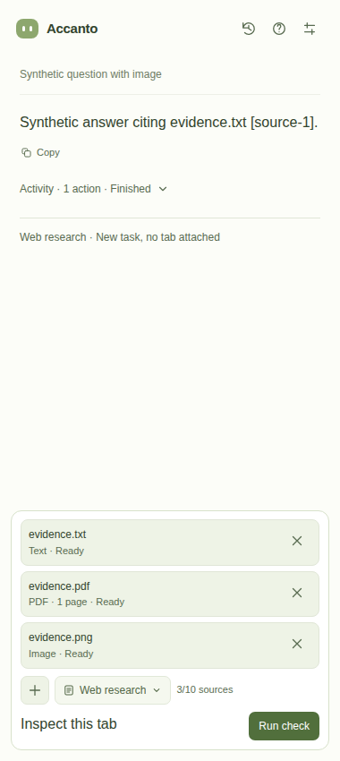
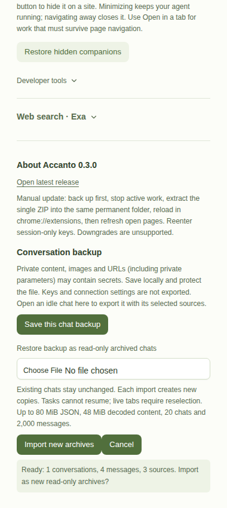
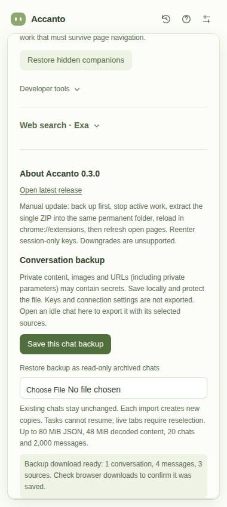
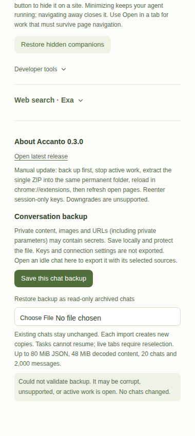
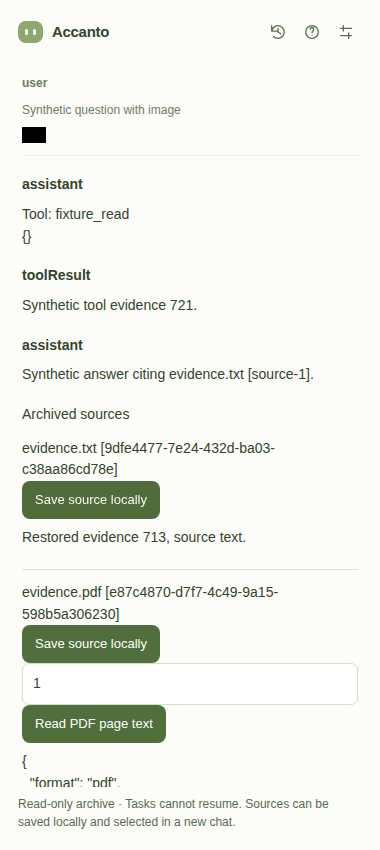

# GitHub distribution and portable backups

Implementation base: `b5db839b365bfd1ad53c3268c7fcaecb8ca436cf`,
isolated `feat/github-distribution` worktree. Version **0.3.0** throughout
package, lock and manifest. The public manifest key and extension identity
`iojliefpiallbakabkahmiaadgmlfjkf` are unchanged. No new permissions,
dependencies, updater service, executable download or store integration.
No tags, pushes, releases or merges were performed during implementation.

## Release operator, later and separately authorized

1. Review the feature branch and maintained `CHANGELOG.md`. Parent owns review,
   feature-branch push and any subsequent publication decision. This task does
   **not** authorize merging or publishing 0.3.0.
2. Configure GitHub protections: reviewed/required-check changes on `main`;
   restrict creation, deletion and movement of `v*` tags to release operators;
   protect the `release` environment with trusted reviewers and permitted tags.
   Workflow definitions themselves must receive review. An ancestor check cannot
   protect against someone permitted to tag arbitrary workflow code; tag and
   environment protection are required, not implemented by a YAML file.
3. Once a reviewed release commit is on `main`, on Linux with Node 22+, `zip`
   and `unzip`, run:

   ```sh
   npm ci
   npm run package
   npm run release:prepare -- v0.3.0
   npm run test:release
   npm run test:distribution
   npm run test:permissions
   npm run test:panel-state
   npm run test:identity
   npm run test:fixtures
   npm run release:prepare -- v0.3.0 --verify
   ```

4. Only after separate publication authorization, create/push the matching
   `vVERSION` tag on that reviewed main commit. The workflow checks exact
   tag/package/root-lock/lock-package/manifest agreement and main ancestry,
   serializes publication, and runs all listed gates before uploading verified
   assets. Test job permissions are read-only. Only the protected publish job has
   `contents: write`.
5. Publication creates a draft, uploads the directly installable ZIP and
   `SHA256SUMS`, downloads them again and checks bytes/hashes before publishing.
   Release notes come from the version's maintained changelog section. No
   `--clobber` is used. A rerun accepts existing byte-identical assets, completes
   missing assets only on a draft, and fails on differing immutable assets.
   Linux packaging normalizes timestamps/order/ZIP extra fields; tests verify
   repeated packaging of the same build is byte-identical. Do not rebuild an old
   release with changed tools and expect identical bytes. Investigate mismatches;
   never silently replace a published asset.

GitHub hosting remains subject to repository retention/removal. The developer CI
artifact route is preserved, including its extra wrapper ZIP and expiry. Releases
have a single extension ZIP with `manifest.json` at root, not a nested artifact.
Checksums detect corruption, not malicious publication. The workflow was inspected
and locally tested through asset preparation and a synthetic `gh` adapter,
**not executed on GitHub**.

## Backup contract and schema

Portable format `pi-accanto-archive`, version **1**, uses an explicit domain
allowlist. Export is **one chosen conversation per file**, repeated for other
chats, not an automatic whole-profile dump. `Conversation.entries()` is the
supported Pi Durable 1.4.0 readable API; the attachment collection snapshots its
owned, idle records and immutable blobs. We deliberately do not open durable
IndexedDB internals, copy Agent/Live/Inbox/Provider/Codemode documents, restore
submission IDs or call APIs that could execute recovered work.

User/assistant/tool-result text, native image blocks, readable tool-call text,
source IDs/names/citations, unavailable tab references, current file bytes and a
plain-text transcript survive. Removed originals and unsubmitted composer drafts
are outside this backup. Export also bounds the durable entry scan at 2,000.
Existing source limits remain; total decoded backup content is capped at 48 MiB,
JSON input/output at 80 MiB, 20 chats, 2,000 messages, 100 blocks per message,
10 sources per chat. Text blocks are at most 2 MiB. PDF parsing uses existing
bounded, non-eval PDF.js reading and a 30-second read deadline; images undergo
header/pixel checks and actual local decode. Source IDs, types, schema versions,
canonical base64, UTF-8 and image metadata are checked before mutation.
Local source names must remain supported PDF/text/image filenames, without path
separators or control characters; malicious executable filenames are rejected.

Restoration is explicitly **read-only archived conversations**, not executable
Pi task state. Native messages and citations remain readable; text sources are
inline, PDF pages can be read locally, images viewed, and originals saved locally
for manual attachment to a new chat. A live tab is an unavailable reference,
never an old browser binding. No source URL is fetched on restore. Archives get
fresh conversation IDs; source citation IDs stay inert and scoped to their chat.
Each confirmed import creates new copies, including repeated imports.

Archives use a separate version-1 IndexedDB database. Content and lightweight
history headers commit in one transaction, including synchronous quota failures
and asynchronous aborts; queued writes are rolled back on error. There is no
replacement of live conversations or a catalog publication window between stores.
History reads headers only, not all archived attachment payloads.

Backup controls exist only in extension tabs, not the public companion iframe.
Active model work/source imports share a browser lock; backups take it
exclusively without waiting. Export also requires the current idle owner and
flushes attachment writes; other chat owners cause a clear refusal rather than
stealing their leases. Same-panel composer/source/context changes are blocked
during backup. File validation precedes an explicit count summary/confirmation;
Cancel discards the pending selection before any write. Atomic commit itself is
not interruptible. Close a panel to abandon an export/validation before commit.

Stored keys, auth headers, connection settings, endpoints, lease/run/window/tab/
document/session identities are excluded by selection. Private content can still
contain secrets and URLs with private parameters. Backups are unencrypted local
downloads; there is no upload or secret-free guarantee. Schema versions may
evolve. Downgrades are unsupported. Archives currently have no individual delete
control; clearing extension storage removes them, and downloaded files must be
deleted separately.

## Evidence

Final Linux run on 2026-11-12 passed `npm run package`, release preparation and
checksum re-verification, `test:release` (3), existing `test:distribution` (4),
`test:permissions` (2), `test:panel-state` (5), `test:identity` (1), and complete
`test:fixtures`: browser controls, conversations, PDFs including visual/timeout
checks, research, companion, attachments/geometry, and portable schema (4) plus
real Chromium restore. No required fixture was skipped. The PDF visual check
completed in 38.87 seconds, including its deliberate 30-second timeout.

Local candidate ZIP SHA-256, not a published asset:

```text
33c5e406fe6f3858a2d27b2afdb5ca1e0bb9752fbf035deedfee1c5e47939e10  pi-accanto-0.3.0.zip
```

New checks:

- `test-release.mjs`: actual ZIP preparation, mismatched tags/lock versions,
  checksum corruption, missing ZIP/runtime asset, forbidden `.env` archive
  member and byte-identical repeat packaging. The workflow's actual publication
  shell also runs against an offline synthetic `gh` adapter: first publication,
  no-write rerun, partial-draft completion, differing-byte refusal and rejection
  of unrelated existing assets before publishing.
- `test-portable.mjs`: allowlisted canaries, malformed/version/type/ID/base64/
  duplicate-source boundaries, 2,001 messages, oversized text and 50 MiB aggregate
  rejection, executable/path-traversal filename refusal, inert tool-call text,
  native image selection and unavailable tab references.
- `test-backup-ui.mjs`: generated faux-agent chat through real Pi Durable APIs;
  native image and actual tool-result text; file-picker PDF/text/image sources;
  actual local download; fresh profile **and different extension identity**
  restore; untouched preexisting live catalog; native image/history/source-byte
  equality; local PDF reading and text download; zero imported keys, owner locks
  or external HTTP requests; unsupported/malformed binary backups; other-owner
  refusal; duplicate copies; transaction abort and synchronous quota-failure
  rollback. External routes are blocked, no paid service/private browsing.

Existing distribution, permissions, panel-state, identity and complete fixture
gates remain in CI. Panel-state's controlled environment was extended with the
new shared lock and backup flag; all original Stop-stage assertions are retained,
including synchronous draft clearing. An intermediate test run caught that
regression; it was fixed before final validation. Atomic-failure tests also
caught an already-aborted transaction edge, fixed by preserving the rollback
error path. The existing PDF visual fixture caught delayed Loading feedback from
early lock acquisition; reservation is now immediate and the lock gates byte
reading instead. Its focused rerun passed, including the real 30-second timeout.
The companion fixture now exposes its production command handlers only in a
disposable copied worker, since module workers do not expose classic globals and
Chrome forbids dynamic import during worker evaluation. Production has no such
test globals. Import cancellation is disabled once a transaction starts; a
fixture attempts that overlap while writes are queued and confirms completion.

Selected sanitized screenshots below are synthetic Chromium fixtures, inspected
visually. The local Playwright interaction trace is
`test-results/distribution/backup-trace.zip`, intentionally not committed.

| Before | After | Why |
| --- | --- | --- |
| Backup content inherited dense default styling | Section spacing, 12px help, distinct status surface | Match existing Settings, keep warnings readable |
| File content could dominate History reads | Lightweight archive headers | History does not read every binary payload |
| Existing composer plus and controls | Unchanged centered plus and 32px geometry | Preserve compact interaction target layout |







Linux Playwright is the verified platform. Windows native permission/desktop
tests were not run. No mutation-test tool is installed in this environment, so
mutation testing was not performed. Actual GitHub publication, protection
configuration, OS-native save dialogs and live-provider/model interpretation
are outside these offline fixture claims.
